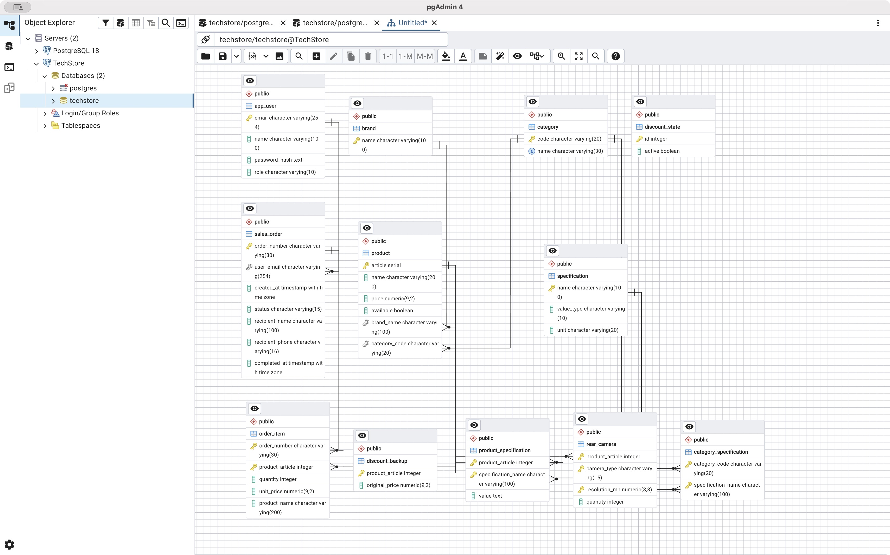

# TechStore

Магазин техники с REST API на Java 17, Spring Boot и Spring Data JPA.
Можно добавлять и редактировать товары, искать их по фильтрам, работать
с пользователями, справочниками и скидками. Данные хранятся в PostgreSQL.

## Запуск

Нужны JDK 17 или новее и запущенный Docker Desktop.
Из папки проекта:

```sh
make run
```

PostgreSQL запускается в Docker, приложение — через Maven на компьютере.
После запуска API доступно в [Swagger](http://localhost:8080/swagger-ui.html).
Для остановки приложения — Ctrl+C, затем `make down` для остановки базы.
Данные при этом сохраняются.

Без Make:

```sh
docker compose up -d --wait
./mvnw spring-boot:run
```

В Windows вместо `./mvnw` используется `mvnw.cmd`.
База останавливается командой `docker compose stop`.

Основные команды:

- `make build` — сборка и тесты (`./mvnw clean verify`);
- `make test` — только тесты;
- `make up` / `make down` — запуск и остановка базы;
- `make logs` — журнал базы.

## Настройки базы

По умолчанию: адрес `localhost:5434`, база и пользователь `techstore`,
пароль локальной базы `techstore_local`. Приложение использует порт `8080`.
Для запуска с настройками по умолчанию `.env` не нужен.
Docker Compose читает из `.env` параметры `DB_PORT` и `DB_PASSWORD`
(пример — `.env.example`). Maven этот файл не читает: изменённые параметры
нужно также передать приложению через переменные окружения `DB_URL`
и `DB_PASSWORD`. Для приложения доступны `DB_USER` и `PORT`.
Например, при `DB_PORT=5435` адрес приложения к базе:
`DB_URL=jdbc:postgresql://localhost:5435/techstore`.
Изменение пароля в `.env` не меняет пароль уже созданной базы.

SQL из `db/` создаёт таблицы и справочники при первом запуске с пустым volume.
Hibernate проверяет схему через `ddl-auto=validate`.

## База данных

Таблицы:

- `brand`, `category` — бренды и категории товаров;
- `specification`, `category_specification` — характеристики и их связь с категориями;
- `product`, `product_specification`, `rear_camera` — товары, значения характеристик и камеры;
- `app_user` — пользователи;
- `discount_state`, `discount_backup` — состояние скидки и исходные цены;
- `sales_order`, `order_item` — заказы и их позиции.

Таблицы заказов есть в схеме, но API их не обслуживает.

ER-диаграмма из pgAdmin:



## API

В Swagger есть формы для добавления смартфона, планшета, ноутбука и наушников.
Достаточно заполнить название и цену, остальные поля можно изменить перед
отправкой. Новый бренд из формы создаётся автоматически. Артикул возвращается
в ответе и используется в запросах изменения и удаления.

Основные маршруты:

- `/api/products` — GET: список, POST: создание через JSON;
- `/api/products/{article}` — GET, PUT, DELETE;
- `/api/products/{article}/details` — PATCH основных полей через форму;
- `/api/products/smartphones`, `/tablets`, `/laptops`, `/headphones` — POST форм товаров;
- `/api/users` и `/api/users/{email}` — CRUD пользователей;
- `/api/users/form` — POST формы, `/api/users/{email}/form` — PUT формы;
- `/api/brands` и `/api/brands/{name}` — CRUD брендов;
- `/api/categories` — GET категорий;
- `/api/specifications` — GET списка характеристик;
- `/api/categories/{code}/specifications` — GET характеристик категории;
- `/api/discount` — GET состояния, POST применения, DELETE отмены скидки.

Фильтры товаров: `name`, `brand`, `category`, `minPrice`, `maxPrice`, `available`.
Параметры `page` и `size` задают страницу и её размер.
Примеры запросов находятся в `examples/requests.http`.

PUT заменяет товар целиком. PATCH меняет только заполненные поля формы.
Пароли хешируются BCrypt и не возвращаются в ответах.

## Вход и права доступа

Вход через HTTP Basic использует email и пароль из базы. При первом запуске
можно создать администратора, передав обе переменные окружения:

```sh
ADMIN_EMAIL=admin@example.com ADMIN_PASSWORD='<ваш пароль>' make run
```

Приложение читает эти переменные из окружения Java. При запуске из IntelliJ
их нужно указать в конфигурации запуска. Если учётная запись с этим email уже
есть, её пароль и роль сохраняются. Если переменные не заданы, существующие
пользователи могут входить как обычно.

| Запрос | Кто может выполнить |
| --- | --- |
| GET каталога, справочников и состояния скидки | Любой вошедший пользователь |
| POST, PUT, PATCH для `/api/products/**` и `/api/brands/**`; POST для `/api/discount` | MANAGER, ADMIN |
| DELETE для `/api/**`, включая отмену скидки | ADMIN |
| Все методы `/api/users/**`, включая формы | ADMIN |

TechStore настроен для локальной демонстрации на `127.0.0.1`. API принимает
учётные данные через HTTP Basic без сессии, а защита CSRF отключена. Если
браузер запомнит учётные данные Basic, остаётся риск отправки запросов от
имени пользователя. Перед использованием сервиса в браузере за пределами
локальной демонстрации настройки безопасности нужно пересмотреть.

### Проверка в Swagger

1. Откройте Swagger без входа и выполните `DELETE /api/products/{article}`.
   Сервер вернёт `401`. Если браузер покажет системный диалог входа, отмените его.
2. Войдите через **Authorize** как администратор, создайте менеджера через
   `POST /api/users/form` и добавьте товар для проверки. Запомните его артикул.
3. В Swagger выйдите из учётной записи администратора и войдите как менеджер.
   Удаление товара вернёт `403`.
4. Войдите снова как администратор. При неактивной скидке удаление того же
   товара вернёт `204`.

### Журнал приложения

Logback выводит сообщения в консоль и в `logs/techstore.log`. Успешные операции
записи отмечаются уровнем INFO. В журнал попадают артикулы изменённых товаров,
смена роли и число товаров, цены которых изменились при применении или отмене скидки. Неудачный вход, отказ в доступе
и ожидаемые ошибки запроса записываются на WARN. Для ошибок запроса записываются
только HTTP-статус и код ошибки. Файлы журнала ротируются. Имена потоков расчёта скидок видны в журнале.

```sh
tail -f logs/techstore.log
```

## Структура проекта

Пакеты находятся в `com.example.techstore`:

- `model` — JPA-сущности товаров, справочников, пользователей и скидок;
- `repository` — Spring Data JPA и фильтры;
- `service` — интерфейсы сервисов, проверки характеристик и расчёт цен;
- `service.impl` — бизнес-логика и транзакции;
- `controller` — REST-контроллеры;
- `dto` — данные запросов, форм и ответов;
- `exception` — ошибки API;
- `config` — настройки BCrypt, OpenAPI и Spring Security, создание стартового администратора;
- `security` — загрузка пользователей из БД, ответы 401/403 и журнал действий.

Характеристики товара хранятся отдельными записями. Проверки обязательных
полей зависят от категории. Пользователи наследуются от абстрактного `User`.
Скидка рассчитывается в потоках `price-worker-N`; исходные цены сохраняются
в базе для отмены. Пока скидка действует, изменение каталога заблокировано.

## Тесты

`make test` запускает тесты JUnit, Mockito и MockMvc с `@SpringBootTest` без подключения к БД.
GitHub Actions выполняет Maven verify на Java 17.

## Формат ошибок

REST API возвращает HTTP-статус и JSON с кодом `error`, сообщением `message`,
подсказкой `hint`, списком ошибок полей `details` и временем ошибки `timestamp` в UTC.
Клиент может использовать стабильный код `error` для выбора действия.
Например, `GET /api/products?minPrice=100&maxPrice=10` возвращает HTTP 400.

```json
{
  "status": 400,
  "error": "INVALID_PRICE_RANGE",
  "message": "Некорректный диапазон цен: minPrice=100, maxPrice=10",
  "hint": "Укажите неотрицательные цены и minPrice не больше maxPrice, например minPrice=10&maxPrice=100.",
  "details": [],
  "timestamp": "2026-11-18T12:00:00Z"
}
```

| HTTP | Коды ошибок |
| --- | --- |
| 400 | `INVALID_PRICE_RANGE`, `INVALID_PAGINATION`, `EMPTY_UPDATE`, `INVALID_EMAIL`, `PASSWORD_TOO_LONG` |
| 400 | `INVALID_DISCOUNT_PERCENT`, `INVALID_DISCOUNT_RESULT`, `INVALID_THREAD_COUNT` |
| 400 | `UNKNOWN_CATEGORY`, `INVALID_CAMERA_CONFIGURATION`, `MISSING_CHARACTERISTIC`, `INVALID_CHARACTERISTIC_VALUE`, `CHARACTERISTIC_NOT_ALLOWED` |
| 400 | `INVALID_PARAMETER_TYPE`, `MISSING_PARAMETER`, `MALFORMED_REQUEST`, `VALIDATION_FAILED` |
| 401 | `AUTHENTICATION_REQUIRED`. Учётные данные отсутствуют или неверны. |
| 403 | `ACCESS_DENIED`. У роли нет доступа к операции. |
| 404 | `PRODUCT_NOT_FOUND`, `USER_NOT_FOUND`, `BRAND_NOT_FOUND`, `CATEGORY_NOT_FOUND`, `CHARACTERISTIC_NOT_FOUND` |
| 405 | `METHOD_NOT_ALLOWED`. Допустимые методы указаны в `Allow`. |
| 409 | `DUPLICATE_EMAIL`, `DUPLICATE_BRAND`, `BRAND_IN_USE`, `DATA_CONFLICT` |
| 409 | `DISCOUNT_ALREADY_ACTIVE`, `NO_ACTIVE_DISCOUNT`, `CATALOG_LOCKED_BY_DISCOUNT`, `EMPTY_CATALOG`, `DISCOUNT_PRODUCT_NOT_FOUND` |
| 415 | `UNSUPPORTED_MEDIA_TYPE` |
| 500 | `PRICE_CALCULATION_FAILED`, `DISCOUNT_CONFIGURATION_ERROR` |
| 503 | `DATABASE_UNAVAILABLE` |

Технические причины обработанных ошибок 500 и 503 записываются в журнал сервера.
